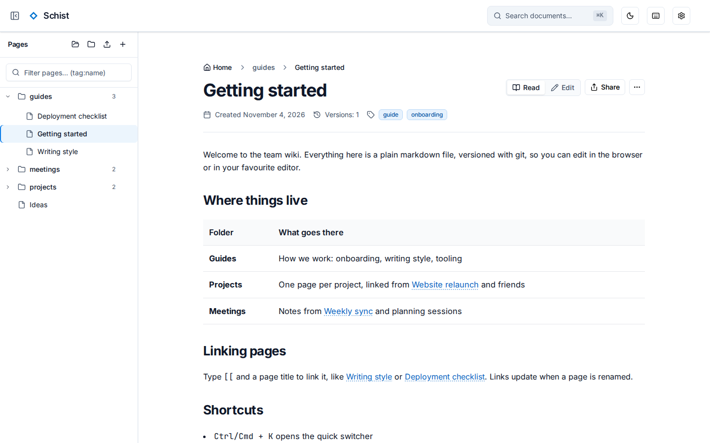
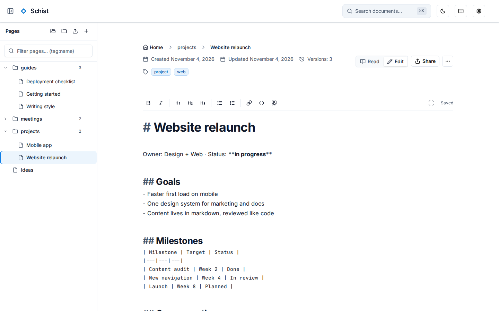
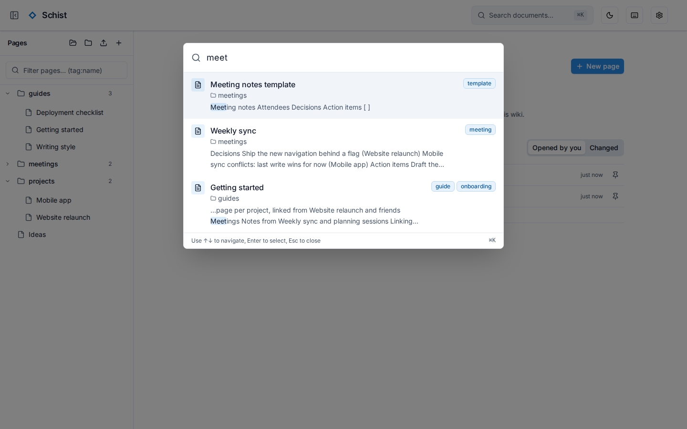
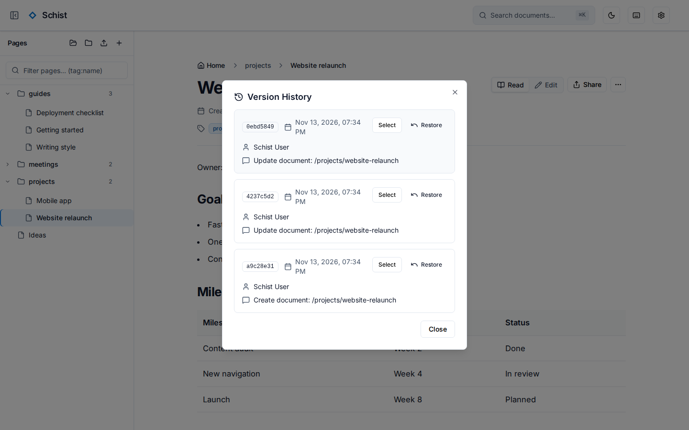

# Schist 🪨

[](https://github.com/MorrisMorrison/schist/actions/workflows/e2e.yml)
[](https://codecov.io/gh/MorrisMorrison/schist)
[](LICENSE)
[](https://morrismorrison.github.io/schist/)

A lightweight, self-hosted markdown wiki with Obsidian-style features in the browser. Your notes stay plain markdown files on disk, versioned with git. There's no database.

<!-- Screenshots are generated from a demo wiki by the "README Screenshots" workflow
     (e2e/readme-screenshots/) on every frontend change to main and published to the
     `screenshots` branch. Regenerate them locally with `make screenshots`. -->
<p align="center">
  <picture>
    <source media="(prefers-color-scheme: dark)" srcset="https://raw.githubusercontent.com/MorrisMorrison/schist/screenshots/document-dark.png">
    
  </picture>
</p>

<table>
  <tr>
    <td align="center" width="33%">
      <picture>
        <source media="(prefers-color-scheme: dark)" srcset="https://raw.githubusercontent.com/MorrisMorrison/schist/screenshots/editor-dark.png">
        
      </picture>
      <br /><sub>Editing in place</sub>
    </td>
    <td align="center" width="33%">
      <picture>
        <source media="(prefers-color-scheme: dark)" srcset="https://raw.githubusercontent.com/MorrisMorrison/schist/screenshots/quick-switcher-dark.png">
        
      </picture>
      <br /><sub>Quick switcher (<kbd>Ctrl/Cmd</kbd>+<kbd>K</kbd>)</sub>
    </td>
    <td align="center" width="33%">
      <picture>
        <source media="(prefers-color-scheme: dark)" srcset="https://raw.githubusercontent.com/MorrisMorrison/schist/screenshots/version-history-dark.png">
        
      </picture>
      <br /><sub>Version history and restore</sub>
    </td>
  </tr>
</table>

## Features

- **Plain markdown on disk:** one `.md` file per page with YAML front matter, in ordinary folders. No database.
- **Linked notes:** `[[wiki links]]` with backlinks and a graph, tags, properties and aliases, ranked full-text search and a quick switcher.
- **An editor in the page:** switch between reading and editing in place, with a toolbar, focus mode, image uploads, templates and Mermaid diagrams.
- **History:** every save is a git commit. Compare and restore any version, with optional backup to GitHub.
- **Accounts and sharing:** passkey sign-in, invite links, expiring public share links and passkey-protected secrets.
- **Import and export:** bring in an Obsidian vault or plain markdown; export a page, a folder or everything.
- **AI assistants:** an optional [MCP](https://modelcontextprotocol.io) endpoint for Claude and other assistants, with scoped personal access tokens.
- **Secure defaults:** authentication, rate limiting and security headers are on unless you turn them off.

## Quick start

```bash
docker run -d --name schist   -p 8080:8080   -v "$(pwd)/data:/app/data"   -e ENV=production   -e SCHIST_JWT_SECRET="$(openssl rand -base64 48)"   -e SCHIST_FRONTEND_URL=http://localhost:8080   ghcr.io/morrismorrison/schist:latest
```

Open http://localhost:8080 and create the admin account with a passkey. For a wiki you keep, follow the [installation guide](https://morrismorrison.github.io/schist/getting-started/installation/): it uses Docker Compose, a fixed secret and a pinned release.

## Documentation

**<https://morrismorrison.github.io/schist/>**

| | |
|---|---|
| **Getting started** | [Introduction](https://morrismorrison.github.io/schist/getting-started/introduction/) · [Installation](https://morrismorrison.github.io/schist/getting-started/installation/) · [First steps](https://morrismorrison.github.io/schist/getting-started/first-steps/) |
| **Guides** | [Writing and linking](https://morrismorrison.github.io/schist/guides/writing-and-linking/) · [Import and export](https://morrismorrison.github.io/schist/guides/import-and-export/) · [GitHub backup](https://morrismorrison.github.io/schist/guides/github-backup/) · [Sharing](https://morrismorrison.github.io/schist/guides/sharing/) · [Secrets](https://morrismorrison.github.io/schist/guides/secrets/) · [AI assistants (MCP)](https://morrismorrison.github.io/schist/guides/ai-assistants/) · [Users and passkeys](https://morrismorrison.github.io/schist/guides/users-and-passkeys/) |
| **Reference** | [Configuration](https://morrismorrison.github.io/schist/reference/configuration/) · [REST API](https://morrismorrison.github.io/schist/reference/rest-api/) · [MCP tools](https://morrismorrison.github.io/schist/reference/mcp-tools/) · [Error codes](https://morrismorrison.github.io/schist/reference/error-codes/) · [Keyboard shortcuts](https://morrismorrison.github.io/schist/reference/keyboard-shortcuts/) |
| **Self-hosting** | [Reverse proxy](https://morrismorrison.github.io/schist/self-hosting/reverse-proxy/) · [Backups](https://morrismorrison.github.io/schist/self-hosting/backups/) · [Upgrading](https://morrismorrison.github.io/schist/self-hosting/upgrading/) |
| **Development** | [Setup](https://morrismorrison.github.io/schist/development/setup/) · [Architecture](https://morrismorrison.github.io/schist/development/architecture/) · [Testing](https://morrismorrison.github.io/schist/development/testing/) · [CI and releases](https://morrismorrison.github.io/schist/development/ci-and-releases/) · [Contributing](CONTRIBUTING.md) |

The pages are the Markdown files in [`docs/`](docs/).

## Development

The Go (Gin) backend is in `backend/`, the SvelteKit app in `frontend/` and the Playwright tests in `e2e/`.

```bash
make install
ENV=development make run-backend   # API on :8080
make run-frontend                  # app on :5173
make test
```

See the [development setup](docs/development/setup.md) and [CONTRIBUTING.md](CONTRIBUTING.md).

## License

[MIT](LICENSE)
