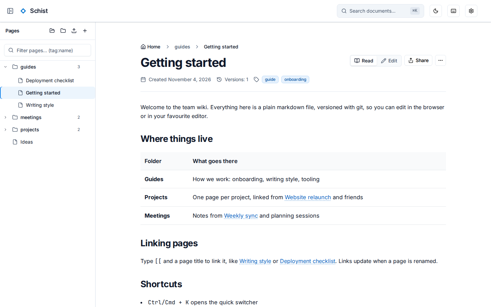
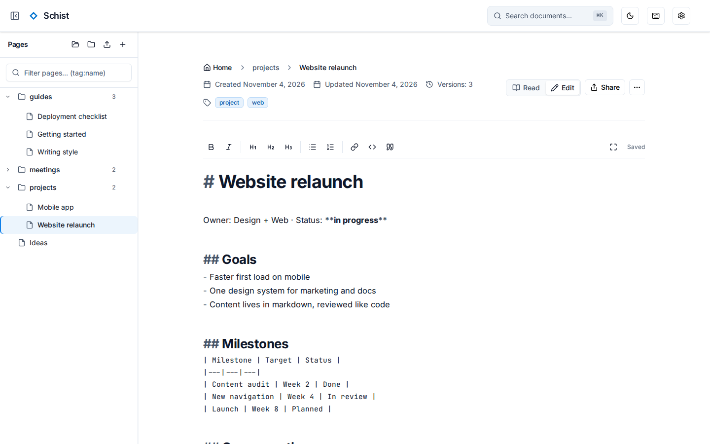
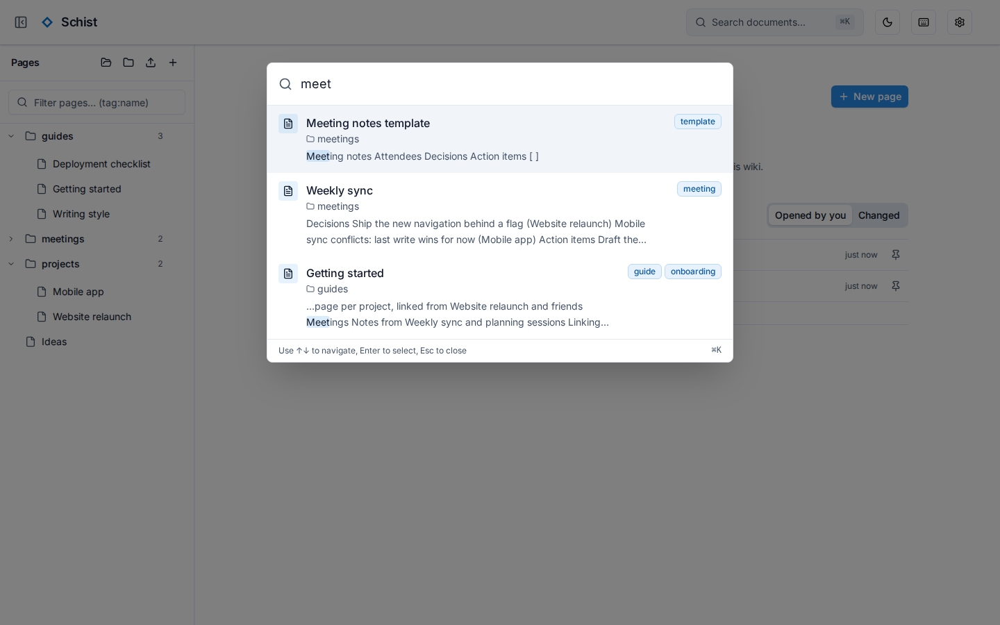
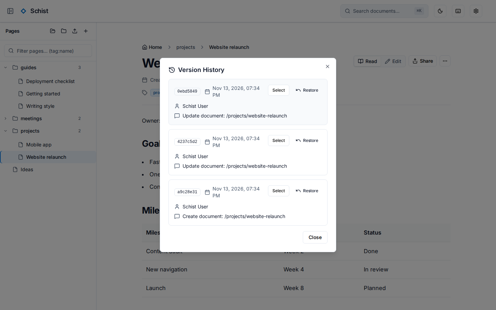

import { Card, CardGrid } from '@astrojs/starlight/components';

<picture>
	<source media="(prefers-color-scheme: dark)" srcset="https://raw.githubusercontent.com/MorrisMorrison/schist/screenshots/document-dark.png" />
	
</picture>

<CardGrid>
	<Card title="Plain files, no database" icon="document">
		One markdown file per page, with YAML front matter, in ordinary folders. Easy to back up and easy to leave.
	</Card>
	<Card title="Linked notes" icon="random">
		`[[Wiki links]]` with backlinks, tags, full-text search and a quick switcher.
	</Card>
	<Card title="Every save is a commit" icon="seti:git">
		Browse a page's versions and restore any of them, with optional backup to a GitHub repository.
	</Card>
	<Card title="Secure by default" icon="seti:lock">
		Passkey sign-in, expiring share links, passkey-protected secrets, rate limiting and security headers.
	</Card>
</CardGrid>

## See it in action

<div class="shots">
	<figure>
		
		<figcaption>Editing in place</figcaption>
	</figure>
	<figure>
		
		<figcaption>Quick switcher</figcaption>
	</figure>
	<figure>
		
		<figcaption>Version history</figcaption>
	</figure>
</div>

## Up and running in minutes

Schist is one container and one data folder.

```bash
docker run -d --name schist \
  -p 8080:8080 \
  -v "$(pwd)/data:/app/data" \
  -e ENV=production \
  -e SCHIST_JWT_SECRET="$(openssl rand -base64 48)" \
  -e SCHIST_FRONTEND_URL=http://localhost:8080 \
  ghcr.io/morrismorrison/schist:latest
```

Open http://localhost:8080 and create the admin account. The [introduction](/schist/getting-started/introduction/) covers Docker Compose and the settings you need, and the [quick start](/schist/getting-started/quick-start/) sets up a development checkout.

## Learn more

<CardGrid>
	<Card title="Configuration" icon="setting">
		Every `SCHIST_*` setting, security headers and logging. [Configure Schist](/schist/guides/configuration/)
	</Card>
	<Card title="REST API" icon="puzzle">
		Documents, folders, search, versions and more. [Browse the API](/schist/reference/api/)
	</Card>
	<Card title="Development" icon="laptop">
		Build, test and contribute. [Start developing](/schist/project/development/)
	</Card>
	<Card title="Design" icon="open-book">
		The architecture and the decisions behind it. [Read the design](/schist/project/design/)
	</Card>
</CardGrid>
