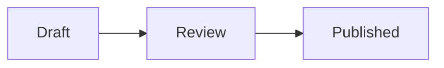

# Writing and linking

How pages are written and stored, and how Schist connects them: wiki links, tags, properties, images and diagrams.

## Pages are markdown files

Each page is a `.md` file in the data folder. Its path in the wiki is its path on disk without `.md`: `/projects/roadmap` is `projects/roadmap.md`. Schist keeps its fields in YAML front matter at the top:

```markdown
---
title: Roadmap
path: /projects/roadmap
created: 2026-11-03T10:30:00Z
updated: 2026-11-03T12:00:00Z
tags:
  - planning
aliases:
  - plan
status: draft
---

# Roadmap

What we build next…
```

Paths use letters, digits, `-`, `_` and `/`, at most 10 levels deep.

## Wiki links

Write `[[Page title]]` to link to a page. Show other text with `[[Page title|text]]`. A `[[target]]` resolves, in this order, to:

1. the page with that title (any case);
2. the page at that path, for a target with a `/`: `[[/lab/devices/router]]`, `[[lab/devices/router]]` or `[[lab/devices/Router.md]]`;
3. the page at the root path `/<slug of target>`;
4. the page that lists it in its `aliases` property;
5. the page whose name (the last part of its path) is the target's slug. So `[[router]]` finds `/lab/devices/router`.

When several pages have the same title, a link finds the one nearest to the page it's on: the one sharing the deepest folder. So `[[Overview]]` in `/projects/a/plan` finds `/projects/a/overview`. If none is nearer than the others, the link doesn't resolve. An alias or name that more than one page has doesn't resolve either. Such a link shows as broken (and in `list_broken_links`) instead of guessing; link the page by its path, e.g. `[[/projects/a/overview|Overview]]`. Click a broken link to create the page.

Title links keep working when you move a page or a folder; path links don't, since the path changes.

**Backlinks** under each page list the pages that link to it. The **graph** view shows a page's links as a network.

Two settings under **Settings → Editor Settings** control this section: **Show links below pages** hides it entirely, and **Show links as a list** opens it as a list instead of the graph. The toggle above the section still switches for the page you're on. Settings are kept per browser.

## Tags

Tags come from two places, and Schist merges them:

- a `tags` list in the front matter;
- `#hashtags` in the text. A tag must start a word, and code is skipped: `fill:#fff`, `page#install` and `` `#not-a-tag` `` are not tags.

Search by tag with `tag:planning` in the quick switcher or the sidebar search.

## Properties

Every other front matter key is a **property**: `status`, `aliases`, `due`, anything you like. Values can be strings, numbers, booleans, lists or objects. Schist keeps them as they are when it saves the page, and its own fields (`title`, `path`, `tags`, `created`, `updated`) always win.

Schist uses two properties itself: `aliases` lets other names link to the page, and `pinned: true` pins it to Home and the sidebar (set it with **Pin to Home** in the page's **⋯** menu, by hand, or through the MCP tools).

## Images

Paste or upload an image in the editor (PNG, JPEG, GIF or WebP, up to 10 MB). Schist stores it under `assets/` and inserts the markdown for it.

## Diagrams

A fenced code block with the language `mermaid` renders as a [Mermaid](https://mermaid.js.org) diagram, with a switch to show the code:

````markdown

````

Mermaid loads only on pages that have a diagram.

## Templates

**New page** offers templates (meeting notes, project readme, API documentation…). They come from the `templates/` folder of the image; set `SCHIST_TEMPLATES_DIR` to use your own.

## Secrets in pages

Write `{{secret:name}}` to show a value from your [secret store](secrets.md). It stays a locked placeholder until you unlock it with your passkey.

## Version history

Every save is a git commit. Open a page's history to see each version, compare two of them and restore one. A restore is saved as a new version, so nothing is lost.

## Deleting

Deleting a page moves it to `/trash`, which is hidden from folders, search and links. Move it back to undo.

> [!WARNING]
> Deleting a **folder** in the web app removes it and the pages in it from disk. Pages that were saved before are still in the git history, but the folder isn't in the trash. Move a folder to `/trash` instead if you might want it back.
